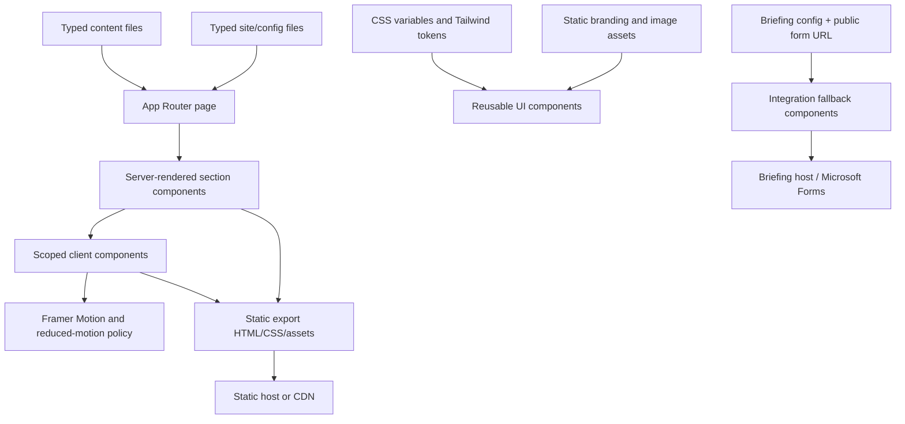
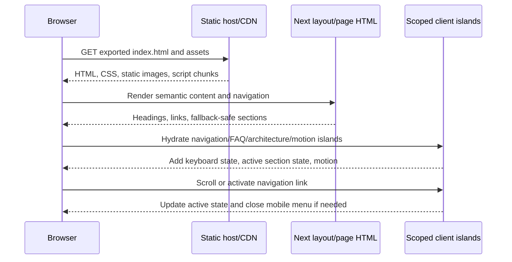
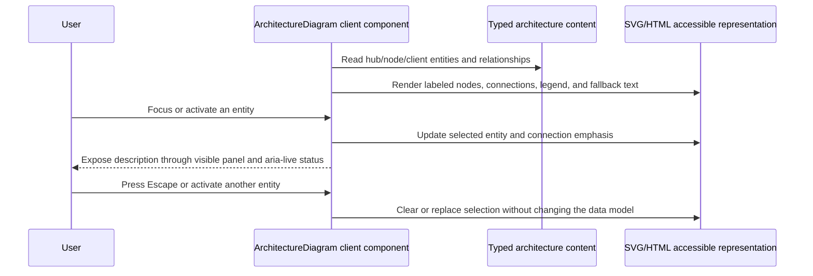
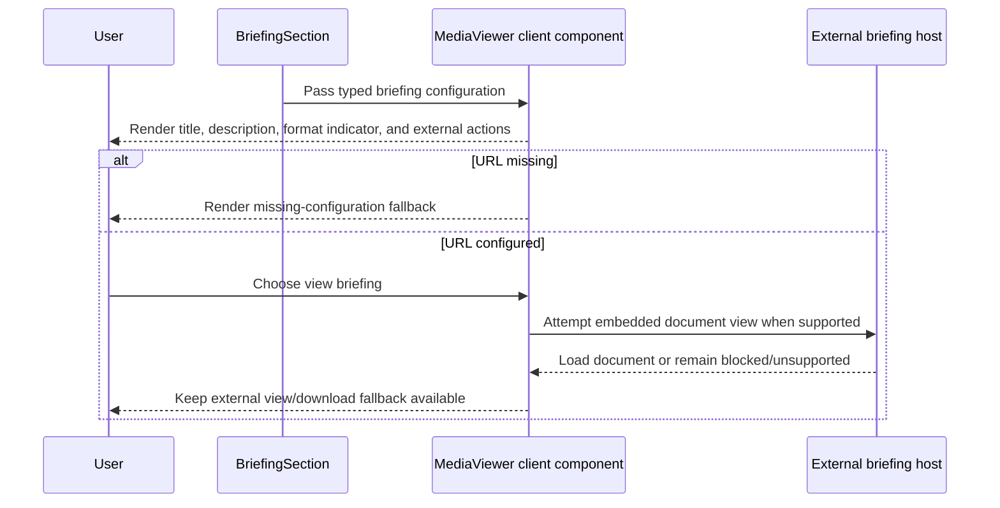
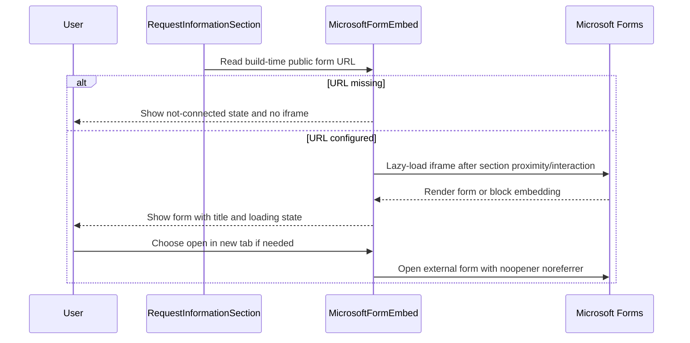

# Technical Design: GEMSTONE Public Website

> **Superseded implementation note:** The content-file layout described below predates the current master configuration. The website now uses `src/content/site-manifest.ts` for editable page text, optional image paths, and the published starter network topology. Use [`../../../HOW-TO-UPDATE-THE-WEBSITE.md`](../../../HOW-TO-UPDATE-THE-WEBSITE.md) for routine updates.

## Overview

GEMSTONE is a public, static-export-compatible Next.js website for the Government Enterprise Modeling and Simulation Trusted Operations Networked Ecosystem. It presents GEMSTONE as a government-owned open-source platform that connects organizations, environments, tools, data, compute, models, simulations, users, and hub services across a distributed ecosystem.

The implementation combines a server-rendered, content-driven page shell with narrowly scoped client components for interaction and motion. The design keeps public claims, editable copy, branding assets, integration URLs, section visibility, design tokens, and motion settings outside page and section logic so routine updates do not require broad component changes. No application backend, database, API route, server action, authentication system, or runtime secret is introduced for this public site.

The visual language takes only broad inspiration from the four supplied screenshots: deep dark surfaces, luminous cyan and blue edges, layered engineering imagery, high-contrast panels, connected systems, and restrained magenta/cyan illumination. The screenshots are reference material, not assets or layouts to copy. The approved GEMSTONE logo remains the authoritative brand asset and is never recreated or altered by the application.

### Design goals

- Make the distributed nature of GEMSTONE understandable without animation.
- Keep public claims easy to review and change before release.
- Make the page usable from 320px through 1920px without horizontal scrolling.
- Keep the initial HTML meaningful when JavaScript, optional assets, or embeds are unavailable.
- Isolate client-side JavaScript to components that require browser state, keyboard interaction, or animation.
- Support static export and deployment to a static host or CDN with no Node.js runtime requirement after build.
- Treat accessibility, reduced motion, performance, and fallback states as design constraints rather than post-build enhancements.

### Non-goals

- No implementation of GEMSTONE platform services.
- No collection or storage of Microsoft Forms responses by the site.
- No centralized data store, proxy, API, or telemetry pipeline for this public page.
- No claims beyond the wording in `kiroprompt.md`.
- No recreation or substitution of official GEMSTONE branding.

## 2. Technical Constraints and Decisions

| Area | Decision | Rationale |
| --- | --- | --- |
| Framework | Next.js App Router with TypeScript | Provides the requested component model, Metadata API, image handling, and static export support. |
| Rendering | Server components by default; client components only for interaction, browser APIs, or animation | Keeps the static HTML useful and limits JavaScript. |
| Deployment | `output: "export"`; static hosting/CDN; no server runtime dependency | Supports the required static-export-compatible architecture. |
| Styling | Tailwind CSS backed by centralized CSS variables/design tokens | Makes visual changes global and keeps raw colors out of components. |
| Motion | Framer Motion only in isolated client components, with CSS/static fallbacks | Provides deliberate motion while preserving reduced-motion and no-JavaScript behavior. |
| Icons | Lucide React Icons | Gives consistent, accessible icon primitives without introducing custom icon assets for ordinary UI. |
| Validation | ESLint, Prettier, TypeScript no-emit check, production build, unit/accessibility/integration tests | Catches type, style, interaction, accessibility, export, and fallback regressions. |
| External form | `NEXT_PUBLIC_MICROSOFT_FORM_URL`, read at build time | Static export cannot safely read deployment secrets or server-side runtime configuration. |
| Briefing | One typed URL in `src/config/integration-config.ts` | Keeps the briefing replacement localized and reviewable. |
| Branding | Asset paths in `src/config/asset-config.ts` | Replacing a logo does not require section changes. |

### Static export constraints

The application must remain compatible with `next build` followed by export output generation:

- Do not use route handlers, server actions, middleware that requires a runtime, API routes, database clients, request-time headers, cookies, or dynamic server data.
- Do not use `getServerSideProps`, incremental revalidation, or runtime image optimization that requires a Next.js server. Images used by the static site must either use prebuilt/static assets or configure image handling for static export.
- The single public route is statically rendered. Any future routes must be explicitly compatible with export.
- Build-time public configuration is acceptable. Secrets are not acceptable in `NEXT_PUBLIC_*` variables.
- The Microsoft Form and briefing host remain external origins. The site embeds or links to them but does not proxy them.
- Client-side fallback logic must not assume that a cross-origin iframe exposes its load/error details. The briefing and form components provide a safe loading state, a timeout/manual fallback, and an always-visible external-open action where appropriate.
- The exported output must contain meaningful headings, text, links, and non-animated explanations even if client JavaScript does not execute.

## Architecture

### 3.1 System architecture



The page is composed from typed content and configuration. Server components render the page structure and copy. Client components are leaf-level islands: navigation, animated backgrounds, architecture selection, FAQ accordion, and integration viewer states. The exported result is a static asset bundle. External form and briefing content are fetched by the browser only when the visitor chooses to view the corresponding section.

### 3.2 Repository structure

```text
src/
  app/
    layout.tsx
    page.tsx
    globals.css

  components/
    layout/
      Header.tsx
      Footer.tsx
      Navigation.tsx
      SectionContainer.tsx
      SkipLink.tsx
    sections/
      HeroSection.tsx
      AboutSection.tsx
      WhyGemstoneSection.tsx
      ArchitectureSection.tsx
      CapabilitiesSection.tsx
      DifferentiatorsSection.tsx
      FAQSection.tsx
      BriefingSection.tsx
      RequestInformationSection.tsx
    ui/
      Accordion.tsx
      ArchitectureDiagram.tsx
      AnimatedSection.tsx
      Button.tsx
      Card.tsx
      GlowBackground.tsx
      MediaViewer.tsx
      NetworkBackground.tsx
      SectionHeading.tsx
      StatusFallback.tsx

  content/
    site-content.ts
    navigation.ts
    capabilities.ts
    differentiators.ts
    faq.ts

  config/
    site-config.ts
    asset-config.ts
    integration-config.ts
    motion-config.ts

  lib/
    accessibility.ts
    motion.ts
    utilities.ts

  types/
    content.ts
    site.ts

public/
  branding/
    gemstone-logo.svg
    gemstone-logo-horizontal.svg
    gemstone-mark.svg
    partner-logos/
  images/
    hero/
    architecture/
    backgrounds/
    inspiration/
  documents/

.env.example
README.md
next.config.ts
postcss.config.mjs
tailwind.config.ts
eslint.config.mjs
prettier.config.mjs
package.json
```

The structure is a responsibility boundary, not a requirement to create empty files. A future developer should find editable text in `src/content`, environment-independent configuration in `src/config`, visual tokens in `globals.css`/Tailwind configuration, and behavior in components and `src/lib`.

### 3.3 Page composition

`src/app/page.tsx` assembles sections in the approved order and checks `siteConfig.sections` before rendering each optional section. It does not contain marketing copy, integration URLs, raw brand colors, or section-specific interaction logic.

```typescript
export default function HomePage() {
  return (
    <>
      <SkipLink />
      <Header />
      <main id="main-content">
        {siteConfig.sections.hero && <HeroSection content={siteContent.hero} />}
        {siteConfig.sections.about && <AboutSection content={siteContent.about} />}
        {siteConfig.sections.whyGemstone && (
          <WhyGemstoneSection items={siteContent.whyGemstone} />
        )}
        {siteConfig.sections.architecture && <ArchitectureSection />}
        {siteConfig.sections.capabilities && <CapabilitiesSection />}
        {siteConfig.sections.differentiators && <DifferentiatorsSection />}
        {siteConfig.sections.faq && <FAQSection items={faqItems} />}
        {siteConfig.sections.briefing && <BriefingSection />}
        {siteConfig.sections.requestInformation && <RequestInformationSection />}
      </main>
      <Footer />
    </>
  )
}
```

The example is an architectural contract. Actual implementation may use a section registry, but section visibility must remain explicit and typed.

## 4. Sequence Diagrams

### 4.1 Initial page load and navigation



### 4.2 Architecture visualization interaction



### 4.3 Briefing fallback flow



### 4.4 Microsoft Forms flow



## Components and Interfaces

### 5.1 Layout and page components

| Component | Rendering | Responsibilities |
| --- | --- | --- |
| `Header` | Mixed | Render logo, desktop navigation, mobile menu trigger, scroll-aware surface, focus behavior, and escape-key close. |
| `Navigation` | Client leaf | Track active section and mobile-open state, manage focus return, and preserve anchor links. |
| `SectionContainer` | Server | Standardize section IDs, max width, spacing, and heading relationships. |
| `Footer` | Server | Render configurable organization name, navigation, release statement, and non-empty optional links. |
| `AnimatedSection` | Client leaf | Add intersection-triggered entrance motion with a static/reduced-motion branch. |
| `SkipLink` | Server | Provide keyboard-accessible skip-to-content target. |

### 5.2 Section components

Each section owns layout and presentation but receives typed data. It must not own global content, URLs, branding paths, or claims.

- `HeroSection`: headline, subheadline, request-information CTA, briefing CTA, and signature network visualization.
- `AboutSection`: “What is GEMSTONE?” copy plus organization/tool/data/compute/GEMSTONE relationship visualization.
- `WhyGemstoneSection`: four feature cards: Bring Your Own Environment, Controlled Collaboration, Security First, and Reuse Instead of Rebuild.
- `ArchitectureSection`: interactive Hub/Node/Client visualization and accessible explanatory copy.
- `CapabilitiesSection`: array-driven capability grid for scalable adoption, controlled proprietary data, marketplace integration, and data transformation.
- `DifferentiatorsSection`: array-driven public claims, with grouping and review-friendly presentation.
- `FAQSection`: accessible animated accordion from independent FAQ content.
- `BriefingSection`: configurable briefing viewer with missing, loading, blocked, unsupported, view, download, and new-tab states.
- `RequestInformationSection`: configurable Microsoft Forms iframe with loading, missing, blocked, and external-open states.

### 5.3 TypeScript contracts

The types below define the data boundary between editable content and UI. They are intentionally free of framework-specific implementation details.

```typescript
export type IconName =
  | "boxes"
  | "database"
  | "globe"
  | "layers"
  | "network"
  | "refreshCw"
  | "server"
  | "shield"
  | "sparkles"
  | "workflow";

export interface ContentLink {
  label: string;
  href: string;
  external?: boolean;
}

export interface HeroContent {
  eyebrow?: string;
  title: string;
  description: string;
  primaryCta: ContentLink;
  secondaryCta: ContentLink;
}

export interface FeatureItem {
  id: string;
  title: string;
  description: string;
  icon: IconName;
}

export interface CapabilityItem extends FeatureItem {
  category?: string;
}

export interface DifferentiatorItem {
  id: string;
  title: string;
  description?: string;
  icon: IconName;
  claimReviewRequired: boolean;
}

export interface FAQItem {
  id: string;
  question: string;
  answer: string;
}

export type ArchitectureEntityKind = "hub" | "node" | "client";

export interface ArchitectureEntity {
  id: string;
  kind: ArchitectureEntityKind;
  label: string;
  description: string;
  x: number;
  y: number;
}

export interface ArchitectureConnection {
  from: string;
  to: string;
  label: string;
}

export interface ArchitectureContent {
  entities: readonly ArchitectureEntity[];
  connections: readonly ArchitectureConnection[];
  distributedPrinciple: string;
}

export interface SiteSections {
  hero: boolean;
  about: boolean;
  whyGemstone: boolean;
  architecture: boolean;
  capabilities: boolean;
  differentiators: boolean;
  faq: boolean;
  briefing: boolean;
  requestInformation: boolean;
}

export interface SiteConfig {
  siteName: string;
  fullName: string;
  title: string;
  description: string;
  canonicalUrl?: string;
  publicReleaseStatement: string;
  sections: SiteSections;
  navigation: readonly ContentLink[];
}

export interface AssetConfig {
  logo: string;
  horizontalLogo: string;
  mark: string;
  heroBackground?: string;
  openGraphImage?: string;
}

export interface BriefingConfig {
  url: string;
  title: string;
  description: string;
  format: "pdf" | "powerpoint" | "unknown";
  allowDownload: boolean;
  allowOpenInNewTab: boolean;
  embed: boolean;
}

export interface IntegrationConfig {
  briefing: BriefingConfig;
  microsoftFormUrl?: string;
}

export type MotionIntensity = "reduced" | "standard" | "enhanced";

export interface MotionConfig {
  intensity: MotionIntensity;
  enableContinuousBackgroundMotion: boolean;
  disableContinuousMotionOnSmallScreens: boolean;
  sectionRevealDurationMs: number;
}
```

### 5.4 Architecture diagram interface

The architecture component uses a typed graph of Hub, Node, and Client entities. The Hub is represented as an integration/service coordination point. The graph must not use labels such as “central data store,” “master repository,” or “all data flows through here.” Connections describe interoperability or service relationships, while node and client descriptions make organizational ownership and local environments explicit.

```typescript
interface ArchitectureDiagramProps {
  content: ArchitectureContent;
  reducedMotion?: boolean;
}

interface ArchitectureDiagramState {
  selectedEntityId: string | null;
  focusedEntityId: string | null;
}
```

The desktop view may use a responsive SVG with stable viewBox coordinates. The mobile view may use the same graph as a vertically ordered, stacked list with labeled relationship rows. Both views must expose the same information and selection semantics.

### 5.5 Integration interfaces

```typescript
interface MediaViewerProps {
  config: BriefingConfig;
}

interface MicrosoftFormEmbedProps {
  url?: string;
  title: string;
  privacyNotice?: string;
}

type EmbedState =
  | "missing"
  | "idle"
  | "loading"
  | "loaded"
  | "blocked"
  | "unsupported";
```

The integration components own presentation state only. They do not submit, read, or store form values. Cross-origin failures are treated conservatively: the user always receives a usable external link when a configured URL exists, and no broken iframe is shown when configuration is missing.

## Data Models

### 6.1 Content files

| File | Contents | Review purpose |
| --- | --- | --- |
| `src/content/site-content.ts` | Hero, about, why GEMSTONE, architecture descriptions, footer copy | Main editable public wording. |
| `src/content/navigation.ts` | Anchor labels and target IDs | Navigation and footer link review. |
| `src/content/capabilities.ts` | Capability array | Add/remove capability without component changes. |
| `src/content/differentiators.ts` | Differentiator claims | Public-release and claims review. |
| `src/content/faq.ts` | FAQ array | Public question and answer review. |

All strings involving government ownership, open source, air-gap deployment, IL-7, approval timing, security layers, deployment timing, distribution, performance, or similar public claims belong in content files or explicitly reviewable configuration. A component may render a claim but may not invent one.

### 6.2 Configuration files

```typescript
export const siteConfig: SiteConfig = {
  siteName: "GEMSTONE",
  fullName:
    "Government Enterprise Modeling and Simulation Trusted Operations Networked Ecosystem",
  title:
    "GEMSTONE | Government-Owned Digital Engineering and Modeling & Simulation Ecosystem",
  description:
    "GEMSTONE connects tools, data, compute, and secure digital environments across government, industry, academic, and international partner organizations.",
  publicReleaseStatement: "Approved for Public Release. Distribution Unlimited.",
  sections: {
    hero: true,
    about: true,
    whyGemstone: true,
    architecture: true,
    capabilities: true,
    differentiators: true,
    faq: true,
    briefing: true,
    requestInformation: true,
  },
  navigation: navigationItems,
};
```

```typescript
export const integrationConfig: IntegrationConfig = {
  briefing: {
    url: "GEMSTONE_BRIEFING_URL_GOES_HERE",
    title: "GEMSTONE Briefing",
    description: "Review the current GEMSTONE briefing.",
    format: "unknown",
    allowDownload: true,
    allowOpenInNewTab: true,
    embed: true,
  },
  microsoftFormUrl: process.env.NEXT_PUBLIC_MICROSOFT_FORM_URL,
};
```

The literal briefing placeholder is treated as missing configuration and must never produce an iframe. The form URL is optional at build time. Because `NEXT_PUBLIC_*` values are embedded during the build, a deployment that changes the form URL must rebuild the static site.

### 6.3 Asset and design-token boundaries

`asset-config.ts` owns all application references to logos and optional site imagery. Official logo files are placed under `public/branding`. Reference screenshots remain under `initial-images` or are copied to `public/images/inspiration` only for design reference; they are not displayed as production content unless separately approved.

`globals.css` owns semantic tokens such as:

```css
:root {
  --gemstone-bg: #071826;
  --gemstone-surface: #0b2239;
  --gemstone-primary: #00d4ff;
  --gemstone-secondary: #4ec3e0;
  --gemstone-accent: #7ee0ff;
  --gemstone-text: #f8fafc;
  --gemstone-muted: #b4c7d6;
  --gemstone-border: rgb(126 224 255 / 0.26);
  --gemstone-focus: #ffffff;
  --gemstone-overlay: rgb(7 24 38 / 0.82);
}
```

Tailwind utilities map to semantic tokens. Components use token-based utility classes and do not scatter raw hexadecimal colors. Token contrast must be verified against normal and large text requirements during accessibility testing.

## 7. Interaction and Low-Level Behavior

### 7.1 Header and navigation

- The header is sticky and occupies a stable layout footprint so the scroll transition does not cause layout shift.
- The initial state visually integrates with the hero; after scrolling, it gains a more defined dark/glass surface.
- Desktop navigation uses anchor links to section IDs.
- Mobile navigation uses a button with `aria-expanded`, `aria-controls`, and an accessible label.
- Opening the mobile menu moves focus into the menu; closing returns focus to the trigger.
- Escape closes the menu. Clicking a navigation link closes it after initiating the anchor navigation.
- Focus indicators remain visible against dark surfaces.
- Active-section styling supplements, but does not replace, link text or semantic structure.

### 7.2 Hero, backgrounds, and visual system

The hero network is a decorative and explanatory visualization. It uses labeled or visually supported nodes for organizations, environments, tools, data, compute, models, simulations, users, and hub services. The primary heading and CTA remain in a high-contrast content layer above the visualization. Decorative network lines use `aria-hidden="true"` unless they are part of the accessible architecture explanation.

Continuous motion is limited to low-cost transforms/opacity where possible. Large canvas particle systems, autoplay video, or unbounded DOM particle counts are excluded. On small screens, continuous background motion is disabled by configuration while key content and static lines remain.

### 7.3 Architecture interaction

The architecture visual must communicate:

- Hub: centralized enterprise services that connect communities.
- Node: mission-specific digital environments connected through the ecosystem.
- Client: user-facing tools, services, data, and compute resources.
- Distributed ownership: organizations and nodes retain their environments and capabilities.

A selected entity updates a visible detail panel and connection emphasis. Hover can enhance the same state, but hover is never the only route to information. Keyboard focus and Enter/Space activation must work on every interactive entity. The static fallback contains the same entity descriptions and relationship labels in a readable DOM list. A legend identifies Hub, Node, and Client without using color alone.

The implementation may render a decorative SVG graph and a semantically ordered list. The list is the source of accessible content; the SVG is a visual enhancement with equivalent labels and relationships.

### 7.4 FAQ accordion

Each question is a button controlling a panel:

- Button has a stable ID and `aria-controls`.
- Panel has a stable ID and `role="region"` when appropriate, with a descriptive label.
- `aria-expanded` reflects state.
- Enter and Space toggle the focused item.
- Collapse and expansion use Framer Motion only when motion is allowed; CSS/static state remains correct without it.
- Multiple items may be open unless product review later requires single-open behavior. The initial design does not impose a restriction not present in the brief.

### 7.5 Briefing viewer

The briefing section starts as a polished card with title, description, document type, and actions. When a valid configured URL is available and embedding is enabled, the viewer may be loaded lazily after the section enters the viewport or the visitor activates “View Briefing.” The external view action remains available.

- Missing placeholder URL: render a missing-configuration card and no iframe.
- Supported configured URL: render loading state, then embedded viewer when it loads.
- Unsupported document or blocked framing: render a clear fallback with View Briefing and Download Briefing when configured.
- New-tab actions use `target="_blank"` and `rel="noopener noreferrer"`.
- The design does not promise that a parent page can inspect cross-origin CSP or `X-Frame-Options`. A conservative timeout/manual fallback prevents an indefinitely blank viewer.
- Download is offered only when `allowDownload` is true and the URL is considered suitable for direct access. Browser and host restrictions may still apply, so external viewing remains available.

### 7.6 Microsoft Forms integration

The request-information section is a surrounding GEMSTONE interface around an external form. It never duplicates form fields, captures responses, injects CSS, or stores submissions.

- `NEXT_PUBLIC_MICROSOFT_FORM_URL` is read during the build.
- Missing or placeholder URL: no iframe is rendered; show “Request Information form has not yet been connected” plus configuration-safe explanatory copy.
- Configured URL: render an iframe with a descriptive `title`, `loading="lazy"`, a responsive aspect-ratio container, and a loading state.
- The visitor receives an external “Open Request Information Form” link when embedding is blocked or inconvenient.
- A privacy notice placeholder is rendered outside the iframe until approved privacy wording is supplied.
- The implementation does not claim to detect every cross-origin embedding failure. A visible external action and timeout fallback provide recovery.

## 8. Algorithms and Formal Specifications

### 8.1 Section rendering

```typescript
function renderEnabledSections(
  config: SiteConfig,
  content: SiteContent,
): React.ReactNode[] {
  const sections: React.ReactNode[] = []

  if (config.sections.hero) sections.push(<HeroSection content={content.hero} />)
  if (config.sections.about) sections.push(<AboutSection content={content.about} />)
  if (config.sections.whyGemstone) {
    sections.push(<WhyGemstoneSection items={content.whyGemstone} />)
  }
  if (config.sections.architecture) sections.push(<ArchitectureSection />)
  if (config.sections.capabilities) sections.push(<CapabilitiesSection />)
  if (config.sections.differentiators) {
    sections.push(<DifferentiatorsSection />)
  }
  if (config.sections.faq) sections.push(<FAQSection items={content.faq} />)
  if (config.sections.briefing) sections.push(<BriefingSection />)
  if (config.sections.requestInformation) {
    sections.push(<RequestInformationSection />)
  }

  return sections
}
```

**Preconditions**

- `config` satisfies `SiteConfig`.
- Every enabled section has its required typed content or component dependency.
- Section IDs are unique and correspond to navigation targets.

**Postconditions**

- Every enabled section appears exactly once and every disabled section is absent.
- Section order is the approved public page order.
- The function does not mutate content or configuration.
- The returned tree contains no unsupported public claim generated by the renderer.

**Loop invariant**

- Before each iteration, all previously appended sections satisfy the enabled-section predicate, uniqueness condition, and approved ordering prefix.

### 8.2 Architecture selection

```typescript
function selectArchitectureEntity(
  content: ArchitectureContent,
  entityId: string,
): ArchitectureEntity | null {
  return content.entities.find((entity) => entity.id === entityId) ?? null
}
```

**Preconditions**

- `content.entities` contains unique IDs.
- `entityId` is a string supplied by a rendered entity control or is otherwise untrusted input.

**Postconditions**

- Returns the matching entity if and only if it exists in the typed content.
- Returns `null` for unknown IDs.
- Does not create a new entity or modify graph relationships.

**Invariant**

- Selection state refers only to an entity in the current content graph or `null`.

### 8.3 Reduced-motion policy

```typescript
function resolveMotionMode(
  configured: MotionIntensity,
  prefersReducedMotion: boolean,
): MotionIntensity {
  if (prefersReducedMotion) return "reduced"
  return configured
}
```

**Preconditions**

- `configured` is one of `reduced`, `standard`, or `enhanced`.
- `prefersReducedMotion` reflects the browser media query when available.

**Postconditions**

- A user preference for reduced motion always yields `reduced`.
- Without that preference, the configured site intensity is preserved.
- The result never enables more motion than the user preference permits.

### 8.4 Integration state resolution

```typescript
function resolveIntegrationState(
  url: string | undefined,
  placeholder: string,
): "missing" | "ready" {
  if (!url || url.trim() === "" || url === placeholder) return "missing"
  return "ready"
}
```

**Preconditions**

- `url` is either absent or a string from build-time configuration.
- `placeholder` is the exact configured placeholder token.

**Postconditions**

- Missing or placeholder configuration never produces an embeddable URL.
- A non-empty configured URL produces `ready`; network and host behavior are handled by the viewer fallback state.
- The function has no network side effects.

## 9. Key Functions with Formal Specifications

### `buildMetadata(config: SiteConfig, assets: AssetConfig)`

- **Purpose:** Map centralized site metadata into the Next.js Metadata API.
- **Preconditions:** Title and description are non-empty; any canonical URL is an absolute approved URL; optional Open Graph image path is safe and static.
- **Postconditions:** The page has a title, description, Open Graph metadata, canonical metadata when configured, and a favicon/brand asset reference when supplied. Metadata does not introduce unsupported claims.
- **Side effects:** None.

### `getIcon(name: IconName)`

- **Purpose:** Resolve a typed content icon to a Lucide component.
- **Preconditions:** `name` is a member of `IconName`.
- **Postconditions:** Returns exactly one known icon component; unknown runtime values use a safe fallback and do not crash page rendering.
- **Side effects:** None.

### `getNavigationTarget(link: ContentLink)`

- **Purpose:** Validate and render internal or external navigation links.
- **Preconditions:** `link.label` is non-empty and `link.href` is a valid anchor or approved external URL.
- **Postconditions:** Internal links remain same-document anchors; external links receive appropriate accessible context and `noopener noreferrer`; no unsupported target is emitted.
- **Side effects:** None.

### `loadEmbedAfterInteractionOrProximity()`

- **Purpose:** Defer external briefing/form loading until needed.
- **Preconditions:** A configured external URL exists; the component is mounted in a browser when using IntersectionObserver or event listeners.
- **Postconditions:** At most one iframe load is initiated; missing configuration never initiates a request; an unavailable observer falls back to interaction-triggered loading; the surrounding section remains usable if loading fails.
- **Loop invariants:** N/A; state transitions are finite and monotonic from `idle` to `loading` to `loaded` or fallback.

### `toggleAccordionItem(id: string)`

- **Purpose:** Update FAQ expansion state.
- **Preconditions:** `id` is a rendered FAQ ID or an unknown string from user-controlled DOM state.
- **Postconditions:** Only a known FAQ item changes state; `aria-expanded` and panel visibility stay synchronized; no answer content is lost or mutated.
- **Side effects:** Client UI state only.

## 10. Example Composition

The following is an illustrative TypeScript composition contract, not application implementation.

```typescript
const page = (
  <SiteShell config={siteConfig} assets={assetConfig}>
    <HeroSection content={siteContent.hero} />
    <AboutSection content={siteContent.about} />
    <WhyGemstoneSection items={whyGemstoneItems} />
    <ArchitectureSection
      content={architectureContent}
      motion={motionConfig}
    />
    <CapabilitiesSection items={capabilityItems} />
    <DifferentiatorsSection items={differentiatorItems} />
    <FAQSection items={faqItems} />
    <BriefingSection config={integrationConfig.briefing} />
    <RequestInformationSection
      formUrl={integrationConfig.microsoftFormUrl}
    />
  </SiteShell>
)
```

Example content update:

```typescript
export const capabilityItems: readonly CapabilityItem[] = [
  ...existingCapabilities,
  {
    id: "new-capability",
    title: "Approved Capability Title",
    description: "Approved public wording goes here.",
    icon: "layers",
  },
]
```

Adding this item must not require changing `CapabilitiesSection`.

## Correctness Properties

### Property 1: Configuration-driven visibility

For every section key, the rendered page contains the section if and only if its corresponding `siteConfig.sections` value is `true`.
### Property 2: Navigation integrity

Every internal navigation target points to exactly one rendered section ID when that section is enabled; disabled sections do not leave active navigation links to missing content.
### Property 3: Content immutability

Rendering any content array does not mutate the source array or its entries.
### Property 4: Claim provenance

Every user-visible claim in differentiator, capability, FAQ, and explanatory copy is sourced from typed content or approved configuration, never constructed from unapproved component prose.
### Property 5: Architecture graph integrity

Every connection endpoint refers to an entity in the architecture graph, and every selected entity is either a known entity or `null`.
### Property 6: Distributed architecture semantics

The architecture representation includes Hub, Node, and Client concepts and explicitly states that nodes and organizations retain local environments; it does not label the Hub as a central data store or imply that all data is stored there.
### Property 7: Accessible interaction parity

Every visual architecture interaction and FAQ state has a keyboard-accessible equivalent and a non-animated DOM representation.
### Property 8: Reduced-motion precedence

When `prefers-reduced-motion: reduce` is active, the resolved motion mode is `reduced` regardless of configured intensity, and continuous motion is disabled.
### Property 9: Integration safety

Missing or placeholder briefing/form URLs never render an iframe or attempt an external request.
### Property 10: Integration recovery

When an external embed is blocked, times out, or is unsupported, the user can reach the external resource through a clearly labeled link when a configured URL exists.
### Property 11: External-link safety

Every new-tab external link includes `rel="noopener noreferrer"` and an accessible indication of external behavior.
### Property 12: Static-export compatibility

The page build completes without runtime-only APIs, server actions, route handlers, or dynamic data requirements, and the exported output contains the public page sections.
### Property 13: Responsive containment

At supported viewport widths from 320px through 1920px, content remains within the viewport without horizontal scrolling caused by the site layout.
### Property 14: Fallback comprehension

If optional images, motion, JavaScript, briefing content, or Microsoft Forms are unavailable, the core headings, copy, links, and instructions remain understandable.
### Property 15: Metadata consistency

The document title and description match centralized site configuration, and canonical/Open Graph metadata appear only when configured with approved values.

## Error Handling

| Condition | User-visible behavior | Implementation boundary |
| --- | --- | --- |
| Missing GEMSTONE logo | Preserve layout with an accessible text/mark fallback and log a development warning only | `asset-config` + branding component |
| Missing hero or optional image | Render static gradient/grid/network fallback with meaningful alt handling | `HeroSection`/image wrapper |
| Image load failure | Hide decorative failure artifact and retain section copy; show an approved fallback only if the image is content-bearing | `MediaViewer`/image wrapper |
| Missing form URL | Show not-connected placeholder and do not render iframe | `MicrosoftFormEmbed` |
| Form framing blocked | Keep external open action visible; explain that the form can be opened separately | `MicrosoftFormEmbed` |
| Missing briefing URL | Show briefing not-configured card and no iframe | `MediaViewer` |
| Briefing framing blocked | Show View Briefing and Download Briefing where configured | `MediaViewer` |
| Unsupported briefing format | Use external viewing fallback and format-neutral document card | `MediaViewer` |
| Reduced motion | Disable or simplify entrance, path, background, and accordion animation | `motion-config` + client islands + CSS |
| JavaScript unavailable | Keep semantic content, anchors, static architecture explanation, and external links usable | server-rendered HTML and progressive enhancement |
| Invalid content/config in development | Fail type checks and surface a clear validation error before deployment | TypeScript/content validation tests |

Error messages must not expose secrets, imply unsupported availability, or make claims about external hosts that the site cannot verify.

## 13. Accessibility Design

- Use one page-level `h1`, then ordered section headings.
- Provide a skip link before the header.
- Use semantic `header`, `nav`, `main`, `section`, `aside`, and `footer` elements.
- Give every section a stable ID and an accessible heading.
- Use native buttons for toggles and controls rather than clickable `div` elements.
- Maintain visible focus styles with sufficient contrast.
- Make touch targets approximately 44x44 CSS pixels where practical.
- Provide descriptive iframe titles for the briefing and Microsoft Forms.
- Keep decorative SVG/canvas/network layers `aria-hidden` and provide equivalent text.
- Do not communicate Hub/Node/Client meaning through color alone; include text labels and a legend.
- Use meaningful alternative text for content images and empty alt text for decorative images.
- Preserve logical tab order at desktop and mobile breakpoints.
- Announce architecture selection changes in a restrained status region when needed.
- Honor `prefers-reduced-motion` in both Framer Motion configuration and CSS media queries.
- Test keyboard navigation, screen-reader landmarks, accordion semantics, iframe fallback, contrast, focus visibility, and zoom/reflow behavior.

## 14. Performance and Responsive Strategy

### Performance constraints

- Prefer server components and static HTML for all non-interactive content.
- Use static optimized images with explicit dimensions and responsive `sizes` values.
- Avoid background video, large canvas systems, unbounded particles, and unnecessary third-party scripts.
- Lazy-load briefing and Microsoft Forms content.
- Disable continuous background motion on small screens by default.
- Animate transforms and opacity instead of layout properties.
- Use one shared motion configuration rather than per-component timers.
- Avoid importing Framer Motion into server-only sections.
- Keep icon imports explicit to reduce bundle size.
- Preload only the truly critical logo/hero asset when justified; do not preload external embeds.
- Validate Lighthouse performance, accessibility, best practices, and SEO in the production build.

### Responsive breakpoints and behavior

The design is verified conceptually and in browser tests at 320, 375, 768, 1024, 1440, and 1920px widths.

- **320–374px:** Single-column content, compact section padding, stacked CTAs, horizontally contained cards, mobile navigation, stacked architecture entities, no continuous background motion.
- **375–767px:** Single-column sections with optional two-column feature cards only where text remains readable; form and briefing viewers use full-width containers.
- **768–1023px:** Tablet layout, two-column content where appropriate, mobile or compact navigation depending on available width, architecture graph may switch to simplified stacked representation.
- **1024–1439px:** Full navigation where space permits, two-column hero, responsive SVG architecture view, multi-column capabilities and differentiators.
- **1440–1920px:** Constrained readable content width with visual depth extending into background; no excessive line length or stretched cards.

Responsive behavior is achieved with CSS layout and content reflow, not duplicated page content. Any visual graph transformation preserves the same accessible information.

### Browser targets

Support current versions of Microsoft Edge, Chrome, Firefox, and Safari. Avoid browser-specific behavior without a fallback. Test native `loading="lazy"`, media queries, focus behavior, SVG text, and iframe behavior in the supported browsers.

## 15. Security and Public-Release Considerations

- Do not place secrets in source, content, public assets, or `NEXT_PUBLIC_*` variables.
- Treat all external URLs as reviewed configuration values. Render only approved briefing and Microsoft Forms hosts.
- Use `rel="noopener noreferrer"` for new-tab links.
- Do not inject external HTML or execute remote scripts.
- Do not proxy, transform, or store form responses.
- Use a deployment Content Security Policy that permits only approved static assets and the configured Microsoft Forms/briefing origins where embedding is required. Final CSP values require deployment review because hosts are not yet supplied.
- Keep security, ownership, IL-level, air-gap, approval-time, deployment-time, performance, and availability wording in reviewable content/configuration files.
- Do not imply a specific ATO, accreditation, certification, classified-network authorization, commercial endorsement, sponsorship, partnership, or guaranteed availability/performance.
- The public-release statement is configurable and must be reviewed before publication.
- Security review, privacy review, public-affairs/public-release review, and cybersecurity review remain deployment gates documented in `README.md`.

## 16. Dependencies

### Runtime dependencies

- Next.js App Router
- React and React DOM
- TypeScript
- Tailwind CSS
- Framer Motion
- Lucide React Icons

### Development dependencies

- ESLint with Next.js/TypeScript rules
- Prettier and any agreed plugin
- TypeScript compiler
- Unit test runner and DOM environment, such as Vitest with Testing Library
- Accessibility assertions, such as `jest-axe` or the equivalent supported by the chosen test runner
- Browser integration runner, such as Playwright, for responsive, keyboard, embed fallback, and production-export checks

Exact versions are selected during implementation and locked in `package.json`/lockfile. The implementation should avoid adding dependencies when a platform or existing dependency supplies the needed behavior.

## Testing Strategy

Implementation proceeds test-first by contract: write a failing test for each behavior, implement the smallest change, then run the relevant checks before moving on.

### Unit tests

- Validate content/config object shapes and unique IDs.
- Verify section visibility behavior for every section flag.
- Verify navigation target generation and external-link attributes.
- Verify motion mode resolution and reduced-motion precedence.
- Verify integration URL placeholder/missing-state resolution.
- Verify architecture entity selection and graph endpoint integrity.
- Verify icon fallback behavior for invalid runtime values.

### Component and accessibility tests

- Render the header and verify landmark/name, skip link, focusable menu controls, `aria-expanded`, and Escape close.
- Render the FAQ and verify button/panel relationships, keyboard toggles, and reduced-motion behavior.
- Render the architecture diagram and verify labels, legend, keyboard entity selection, visible selected detail, and non-animated fallback content.
- Render the briefing/form sections with missing, configured, and blocked states; verify no iframe on missing configuration and visible external fallback links.
- Run automated accessibility assertions and supplement them with manual keyboard and screen-reader checks.

### Integration/browser tests

- Verify smooth anchor navigation and active state at desktop and mobile widths.
- Verify the hero primary CTA targets Request Information and the secondary CTA targets Briefing.
- Verify no horizontal overflow at 320, 375, 768, 1024, 1440, and 1920px.
- Verify the static architecture representation remains understandable when animations are disabled.
- Verify iframe loading states and external fallback actions without requiring Microsoft Forms or briefing-host authentication.
- Verify new-tab links include safe relationship attributes.
- Verify missing-image behavior and content comprehension.
- Verify the page in Edge/Chromium, Firefox, and WebKit where the browser test environment permits.

### Production-build validation

The release check must run:

```text
npm run lint
npm run typecheck
npm run test -- --run
npm run build
npm run prettier:check
```

The production build must complete with static export enabled. The exported artifact must be inspected for the main HTML, static assets, metadata, and absence of runtime-only route requirements. Any configured external URL should be tested separately in a deployment-like environment because local test environments cannot fully reproduce cross-origin framing policy.

### Manual release checklist

- Place approved logos in `public/branding` and verify aspect ratio/transparency.
- Place approved imagery under `public/images` and references under `public/images/inspiration`.
- Replace the briefing placeholder in `src/config/integration-config.ts` and verify embed/open/download behavior.
- Set `NEXT_PUBLIC_MICROSOFT_FORM_URL` at build time and test both configured and missing states.
- Verify CSP, HTTPS, DNS, TLS, domain, analytics approval, and external host allowances.
- Run final accessibility, cybersecurity, privacy, and public-release reviews.
- Confirm every public claim against the authoritative source brief before release.

## 18. Maintainability and README Contract

`README.md` must document:

1. Installing dependencies.
2. Running the development server manually.
3. Running linting, type checking, tests, formatting checks, and production build.
4. Enabling static export and deploying the exported directory.
5. Locating and replacing GEMSTONE logos.
6. Locating inspiration assets and distinguishing them from production assets.
7. Changing colors, typography, motion intensity, and section visibility.
8. Editing hero, about, capabilities, differentiators, FAQ, footer, and public-release content.
9. Adding a capability, differentiator, or FAQ item through typed arrays.
10. Updating navigation targets.
11. Updating the centralized briefing URL and understanding embed fallback behavior.
12. Setting `NEXT_PUBLIC_MICROSOFT_FORM_URL` and rebuilding after changes.
13. Which changes require a rebuild or redeploy.
14. Deployment CSP, domain, HTTPS, and external-host setup.
15. Accessibility, privacy, cybersecurity, and public-release gates.

The README is part of the deliverable rather than an afterthought. It must not claim that the static site can alter Microsoft Form fields or read submissions.

## 19. Implementation Boundaries and Review Gates

The later requirements and task phases should preserve these gates:

- **Content gate:** all supplied wording is transcribed into typed content and no unsupported claims appear.
- **Static gate:** no server-only runtime dependency enters the implementation.
- **Interaction gate:** keyboard and reduced-motion paths work for navigation, architecture, FAQ, and embeds.
- **Fallback gate:** missing assets/configuration and blocked external content remain polished and usable.
- **Responsive gate:** layout is verified across all specified widths without horizontal scroll.
- **Validation gate:** lint, typecheck, tests, formatting, and production build pass.
- **Release gate:** metadata, logos, external hosts, CSP, public-release statement, and all public claims receive final review.

This design intentionally stops at architecture and contracts. It does not implement application code, create runtime components, or select final external URLs that the source brief has not supplied.

## 20. Source Content Inventory and Environment Contract

The implementation must transcribe the authoritative `kiroprompt.md` content without expanding it. The minimum content inventory is:

- **Hero:** “Government-Owned Open Source for Digital Engineering and Modeling & Simulation”; the supplied subheadline; Request Information CTA targeting `#request-information`; View Briefing CTA targeting `#briefing`.
- **What Is GEMSTONE:** the supplied Government-Owned Open Source platform definition, with Organizations, Tools, Data, Compute, and GEMSTONE represented as connected resources.
- **Why GEMSTONE:** Bring Your Own Environment, Controlled Collaboration, Security First, and Reuse Instead of Rebuild.
- **Architecture:** GEMSTONE Hub, GEMSTONE Node, and GEMSTONE Client, with language that organizations and Nodes retain their environments and capabilities.
- **Capabilities:** Scalable Adoption, Controlled Proprietary Data, Marketplace Integration, and Data Transformation.
- **Differentiators:** Fully Government-Owned Open Source; Air-Gap Deployment; Multiple Security Layers Including IL-7; Secure Libraries for Application Development; Distribution Pipeline for New Capabilities; Custom Applications Approved Within Minutes; Development and Deployment of Tailored Environments in One Day; Unified Plugin System; Approved and Hardened Python Libraries; Deploy Models and Simulations as API-Consumable Services; Software Development Kit; Distributed Simulation Enablement.
- **FAQ:** the four supplied questions and answers, including the supplied audience wording and capability/differentiator summaries.
- **Briefing:** the supplied title, description, placeholder URL, View Briefing, Download Briefing, and Open in New Tab actions.
- **Request Information:** the supplied title/subtitle and external Microsoft Forms integration. The website does not replicate the form fields.
- **Footer:** GEMSTONE full name, About, Architecture, Capabilities, FAQ, Briefing, Contact, and configurable “Approved for Public Release. Distribution Unlimited.”

The header’s Contact link must not point to a missing section. Unless an approved standalone Contact section is later added, it targets the Request Information section or another approved footer contact target.

### `.env.example`

The implementation must include this explicit example without secrets:

```text
# Optional. Set before the static build to enable the Microsoft Forms iframe.
NEXT_PUBLIC_MICROSOFT_FORM_URL=
```

The briefing URL is intentionally not an environment variable. It is configured once in `src/config/integration-config.ts`, as required by the source brief. Any change to either public configuration value requires a new static build and redeployment.

### Static export configuration contract

The implementation should configure the Next.js build with the equivalent of:

```typescript
const nextConfig = {
  output: "export",
  images: {
    unoptimized: true,
  },
}

export default nextConfig
```

The exact project configuration may include additional approved settings, but it must preserve static export compatibility and avoid introducing a runtime server dependency. The image setting is required only when the chosen Next.js image strategy would otherwise require runtime optimization; implementation must still use explicit dimensions, responsive sources, and optimized static assets.
